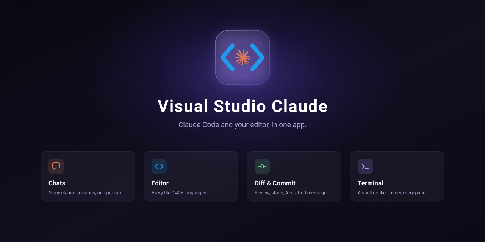

<div align="center">



# Visual Studio Claude

**Claude Code and your editor, in one app.**

[](https://github.com/vsclaude/visual-studio-claude/actions/workflows/ci.yml)
[](LICENSE)
[](https://electronjs.org)

</div>

---

Claude Code in a terminal, an editor beside it to read what it changed — Visual Studio Claude puts both in one window. Chats, files, diffs, a terminal and the commit are all tabs over the folders you already work in.

https://github.com/user-attachments/assets/11e690e6-e3a0-4d2a-893c-ec053ba308d7

## Install

Every build is **unsigned**, so each OS objects in its own way. That is what the last line of each section is about.

### macOS

macOS 12 (Monterey) or newer, Apple Silicon or Intel.

```bash
curl -fsSL https://raw.githubusercontent.com/vsclaude/visual-studio-claude/main/install.sh | bash
```

[`install.sh`](install.sh) picks the build for your architecture and copies it into `/Applications`. Run it again to update, or `| bash -s 1.0.0` to pin a version.

Use `curl` rather than a browser: macOS quarantines a download and Gatekeeper then calls the app _"damaged"_, which only ever means unsigned. A `.dmg` from [Releases][releases] works too, after `xattr -dr com.apple.quarantine "/Applications/Visual Studio Claude.app"` — which skips the check rather than passing it.

### Linux

x64. The AppImage from [Releases][releases] is the whole install.

```bash
chmod +x Visual-Studio-Claude-*-x64.AppImage
./Visual-Studio-Claude-*-x64.AppImage
```

It needs FUSE (`sudo apt install libfuse2` on Debian and Ubuntu), or `--appimage-extract-and-run` without it.

### Windows

x64. The `.exe` from [Releases][releases] is an NSIS installer. SmartScreen stops it: _More info_ → _Run anyway_.

[releases]: https://github.com/vsclaude/visual-studio-claude/releases

Visual Studio Claude is developed and used day to day on macOS; the Linux and Windows builds come out of the same workflow and the tests run on Linux, but assume rough edges. `claude` is needed only for agent sessions and the AI features — not to start the app.

## From source

Needs [Bun](https://bun.sh) 1.3+ and Node 20+.

```bash
git clone https://github.com/vsclaude/visual-studio-claude.git
cd visual-studio-claude
bun install
bun run dev      # bundles the main process, starts Vite, launches Electron at it
```

`bun run test`, `lint`, `typecheck` and `build` are the rest. A `Makefile` wraps packaging: `make dmg` for this machine's architecture, `make help` for the others. Builds are unsigned unless `SIGN=1`.

## Documentation

- **[`docs/design.md`](docs/design.md)**: what each panel is for and why it behaves as it does. Read this before changing one.
- **[`CONTRIBUTING.md`](CONTRIBUTING.md)**: the layout, the IPC contract the main process and the renderer talk over, and where the seams are.
- **[`SECURITY.md`](SECURITY.md)**: the security model, and how to report a vulnerability.

Contributions are welcome. A new agent CLI and a new panel are both designed to be added to. Small fixes need no ceremony; anything structural is worth an issue first.

## License

[MIT](LICENSE).
